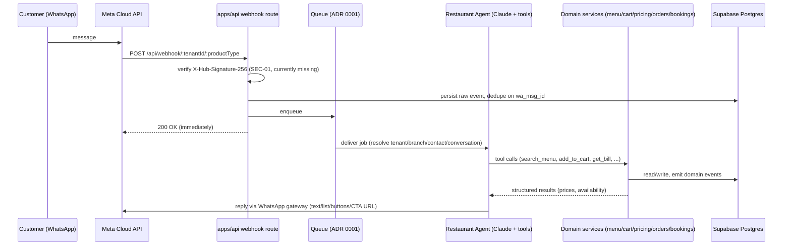
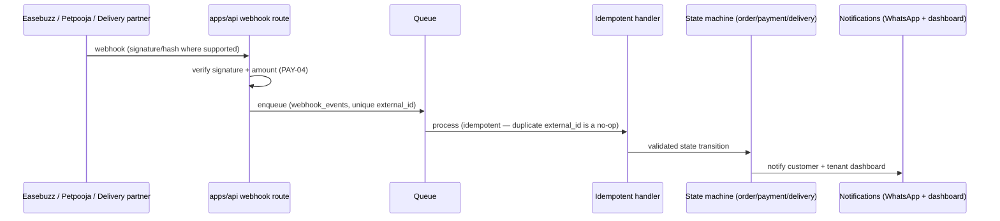

# KOT.ai — Architecture (Phase 0)

Adapted from brief Section 5, confirmed against the pruned repo. See `docs/REUSE_MAP.md` for which pieces are reused vs. net-new.

## Stack

| Layer | Technology | Status |
|---|---|---|
| API / workers | Fastify 4, Node 22, TypeScript (`apps/api`) | reused |
| Web | Next.js 14 App Router, Tailwind (`apps/web`) | reused |
| DB / Auth / Storage | Supabase Postgres + RLS (+ pgvector for KB) | reused |
| Queue / locks / cache | Redis present; **no durable queue yet** — BullMQ vs. Postgres queue decided in ADR 0001 | gap, Phase 2 |
| AI | Anthropic Claude, tool use for the restaurant agent (new path; old marker-based pipeline removed with the bots that used it) | extend |
| WhatsApp | Meta Cloud API (+ Twilio fallback) | reused |
| Payments | Easebuzz, currently platform-wide creds | extend → per-tenant (SEC, PAY epics) |
| POS | Petpooja + manual adapters | net-new |
| Delivery | Shadowfax / Borzo / Porter + manual adapters | net-new |
| Geocoding | Google Maps (behind an adapter interface) | net-new |
| Voice notes | Sarvam / Deepgram STT (outbound calling pipeline removed) | reused (STT only) |
| Email | Resend · Errors: Sentry | reused |
| Hosting | Render (API+workers), Vercel (web) | reused; region TBD — see `docs/PLAN.md` open questions |

## Request flow



## External webhook flow (payments, POS, delivery)



## Module layout (apps/api/src — net-new `modules/` and `integrations/`)

```
apps/api/src/
  modules/restaurant/
    agent/           # system prompt builder, tool definitions, tool handlers (AGT)
    menu/            # menu read model, availability, search (MENU)
    cart/            # server-side cart (CART)
    pricing/         # bill calculator, offers engine, price lock (PRC)
    orders/          # order service + state machine (ORD)
    bookings/        # table booking service + state machine (BKG)
    serviceability/  # radius + partner coverage checks (SRV)
    hours/           # branch hours, cut-offs, closures (BR)
    complaints/      # (CMP)
    refunds/         # (PAY)
  integrations/
    pos/             # PosAdapter interface, petpooja/, manual/ (POS)
    delivery/        # DeliveryAdapter interface, shadowfax/, borzo/, porter/, manual/ (DLV)
    payments/        # PaymentAdapter interface, easebuzz/ (PAY)
    geo/             # GeocodingAdapter, google/ (SRV)
  queue/             # job definitions, workers (QUE)
```

`apps/web/src/app/`: `(dashboard)/restaurant/...` (tenant screens, DSH epic), `(platform)/platform/restaurant/...` (platform console, CON epic), `o/[tenant]/[branch]/...` (public ordering page, WEB epic), `t/[orderRef]/...` (tracking page, WEB epic) — all net-new, added alongside the reused dashboard shell/auth/billing/team screens.

## Key architectural gaps to close before payments go live (Phase 2, brief §4/§21)

1. No webhook signature verification (SEC-01).
2. No durable queue — inbound/payment/POS/delivery processing is in-process after the 200 ack (QUE-01, ADR 0001).
3. Easebuzz credentials are platform-wide, not per-tenant encrypted (SEC-02, PAY-02).
4. No tool-calling agent infrastructure yet — existing Alphabot AI pipeline used text markers; that pipeline's bots are removed, so the new restaurant agent is built directly on Claude tool use rather than retrofitted (AGT-01).
